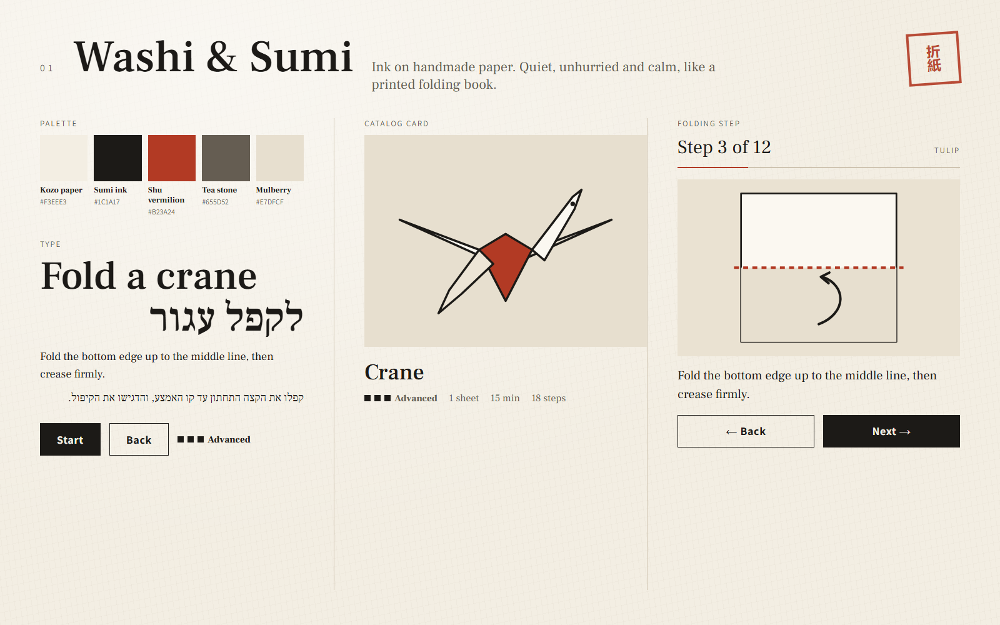
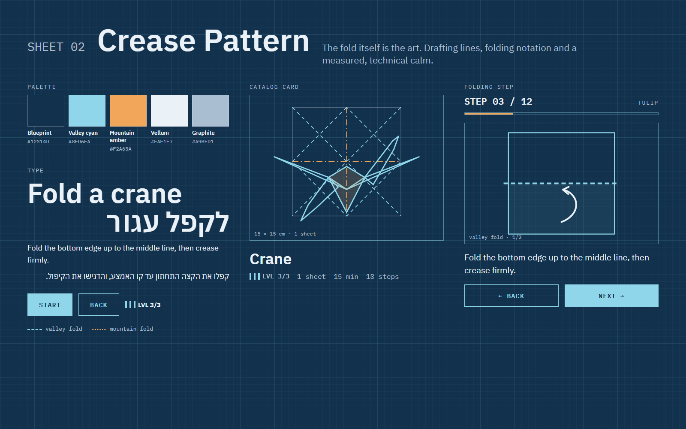
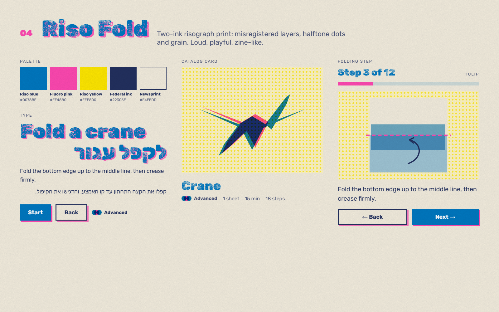
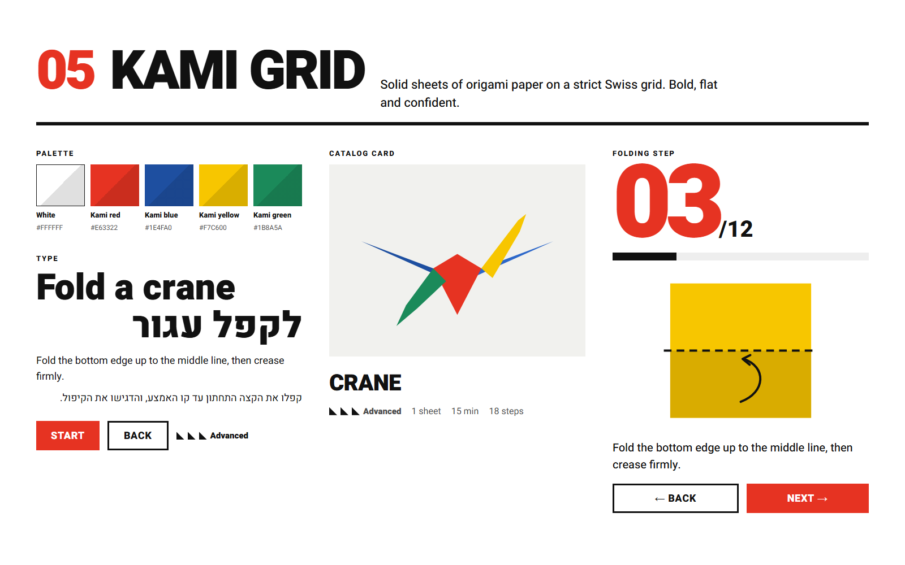

# Archive: style options that were not chosen

Status: **archived**. The owner chose option 3, **Workbench**. The four options below are kept for reference only. They are not planned work.

The final style is described in [docs/design/README.md](../../../README.md). Round 2 (the Workbench variations) is in [../round-2/](../round-2/README.md).

## Why a new style

The first mockups worked, but they looked like a generic app template:
- rounded white cards with a 1px grey border on a pale grey background
- a stock "SaaS" blue as the only brand color
- pill-shaped badges
- emoji used as icons (🦢 🔍 🎉)
- the system font (Segoe UI)

None of that says *paper* or *folding*. Each option started from a real paper or print tradition, so the product has a point of view.

## How to read the boards

Each image is a 1600×1000 board with the same content:
1. **Palette**: five named colors with hex values
2. **Type**: a display line in English and Hebrew, body text in both languages, buttons and the level indicator
3. **Catalog card**: the Crane guide as it would appear in the catalog
4. **Folding step**: step 3 of the Tulip guide, with progress, the fold diagram, the instruction and Back/Next

| # | Name | One-line idea | Mood | Board | Result |
|---|---|---|---|---|---|
| 1 | Washi & Sumi | Ink on handmade paper | calm, crafted, adult | [01-washi-sumi.png](01-washi-sumi.png) | archived |
| 2 | Crease Pattern | The fold diagram is the brand | precise, technical, nerdy | [02-crease-pattern.png](02-crease-pattern.png) | archived |
| 3 | Workbench | A crafting table with taped scraps | warm, tactile, hands-on | [../round-2/03-workbench.png](../round-2/03-workbench.png) | **chosen** |
| 4 | Riso Fold | Two-ink risograph zine | loud, playful, young | [04-riso-fold.png](04-riso-fold.png) | archived |
| 5 | Kami Grid | Solid origami sheets on a Swiss grid | bold, flat, confident | [05-kami-grid.png](05-kami-grid.png) | archived |

---

## 1. Washi & Sumi

**Meaning.** Origami is quiet and patient work. This style looks like a well-printed folding book: warm handmade paper, black sumi ink and one vermilion accent, the color of a Japanese name seal (hanko). It says: slow down, this is a craft.

**Language**
- **Color:** almost monochrome. Vermilion (`#B23A24`) is used only for what matters: the fold line, the progress mark and the current step. Nothing else competes with it.
- **Type:** *Frank Ruhl Libre*, a serif with excellent Hebrew, for headings and reading text. *Assistant* in small spaced capitals for labels and buttons. Serif reading text gives a book-like rhythm.
- **Shape:** square corners, no shadows, no cards. Sections are separated by hairline rules and white space, as in a printed page.
- **Illustration:** thin ink outlines over cream paper tones. The diagram reads like a drawing in a folding book.
- **Signature details:** a red seal mark (for "completed" or the logo) and a faint paper-fiber texture.

**Good for:** adults, gift-like quality, people who fold to relax.
**Watch out for:** it can feel too serious for children, and it relies on very good illustration. The seal uses Japanese characters only as decoration; we can swap it for a Hebrew or Latin monogram.

## 2. Crease Pattern

**Meaning.** Origami artists design models as *crease patterns*: the flat square with every mountain and valley line drawn on it. This style makes that notation the visual identity. It looks like a drafting sheet or blueprint. The app feels like an exact instrument for folding.

**Language**
- **Color:** dark blueprint navy (`#12314D`) background. Fold lines follow standard origami notation: **valley = cyan dashed line, mountain = amber dash-dot line**. The UI colors *are* the folding legend, so learning the UI also teaches the notation.
- **Type:** *IBM Plex Sans Hebrew* for text and *IBM Plex Mono* for numbers, step counters, labels and measurements ("STEP 03 / 12", "15 × 15 cm").
- **Shape:** square, outlined boxes like frames on a technical drawing. A visible grid in the background. Buttons are outlined; only the primary one is filled.
- **Illustration:** line-only. The crane is drawn over its own crease pattern. Diagrams carry small labels such as "valley fold · 1/2".
- **Signature details:** dimension notes, a fold legend, sheet numbers.

**Good for:** teens and adults, maker and STEM audiences, and teaching real fold notation (it fits the PRD rule that fold diagrams must stay accurate and never mirror).
**Watch out for:** a dark-first theme needs a separate light version for printing and bright rooms. It can feel cold for young children.

## 4. Riso Fold

**Meaning.** A risograph is a cheap two-ink printer loved by zines and art schools. Its look is overprinted colors, slightly misaligned layers, halftone dots and grainy ink. This style is energetic and handmade-in-print. It says: folding is fun, and imperfect is fine.

**Language**
- **Color:** two inks, riso blue (`#0078BF`) and fluoro pink (`#FF48B0`), on newsprint, with yellow halftone as a third "ink" for backgrounds. Where inks overlap they multiply into a dark violet. Body text uses a dark navy ink (`#22305E`) for contrast. Pink is never used for text.
- **Type:** *Rubik Dirt* (a grainy, print-worn cut of Rubik with Hebrew) for big headings only, with a pink "misregistered" offset. *Rubik* for everything else.
- **Shape:** flat ink blocks with no rounded corners. Buttons have a pink offset shadow, like a layer printed slightly off.
- **Illustration:** each model is printed as two offset ink layers on a halftone background.
- **Signature details:** paper grain over everything, halftone dots, overlapping dots for level.

**Good for:** kids and teens, social sharing, a strong memorable brand.
**Watch out for:** the textured display font is for large headings only, never for instructions. The grain overlay must not reduce text contrast. Overprinting is harder to keep consistent across many illustrations.

## 5. Kami Grid

**Meaning.** *Kami* is the Japanese word for the colored square sheets sold for origami. This style uses those sheets as flat color blocks on a strict Swiss-style grid, with heavy black type and huge step numbers. It is bold, flat and confident, like a museum poster or a modern children's book.

**Language**
- **Color:** white and black, plus four pure "paper pack" colors: red (`#E63322`), blue (`#1E4FA0`), yellow (`#F7C600`) and green (`#1B8A5A`). Each guide can get its own sheet color. Swatches show a diagonal fold shadow.
- **Type:** *Heebo* Black, very large, for headings and numbers. The step number is the biggest thing on the step screen ("03/12"), so you can read it from across the table. Heebo Medium for text.
- **Shape:** hard square blocks, thick black rules, no shadows, no rounded corners. The level indicator is small folded triangles.
- **Illustration:** flat solid facets with no outlines. Each facet is a different paper color.
- **Signature details:** giant step numbers, a thick header rule, the diagonal "fold" on color blocks.

**Good for:** every age; the easiest to build and to keep consistent across many guides. Very readable at a distance on a tablet propped on the table.
**Watch out for:** yellow and white need dark text or a black outline. It could slide back toward "generic" if the grid and the giant numbers are softened.

---

## Comparison (original five)

| | Washi & Sumi | Crease Pattern | Workbench | Riso Fold | Kami Grid |
|---|---|---|---|---|---|
| Energy | low, calm | medium, precise | medium, warm | high, playful | high, bold |
| Best age | adults | teens+ | families | kids/teens | all |
| Teaches fold notation | a little | **yes, built in** | a little | no | a little |
| Illustration effort | high | low | medium | high | low |
| Dark mode | needs work | **native** | hard | medium | easy |
| Hebrew fonts | Frank Ruhl Libre, Assistant | IBM Plex Sans Hebrew | Secular One, Assistant, Amatic SC | Rubik, Rubik Dirt | Heebo |

## Sources and re-rendering

- Source of the original five boards: `src/board.html?style=washi|crease|bench|riso|kami` (in this archive folder). It loads its fonts from Google Fonts.
- Re-render from the repo root in PowerShell: `& .\docs\design\archive\style-options\round-1\src\render.ps1` (headless Edge, 1600×1000). The four archived boards are written to this folder. The Workbench board is written to `../round-2/`.
