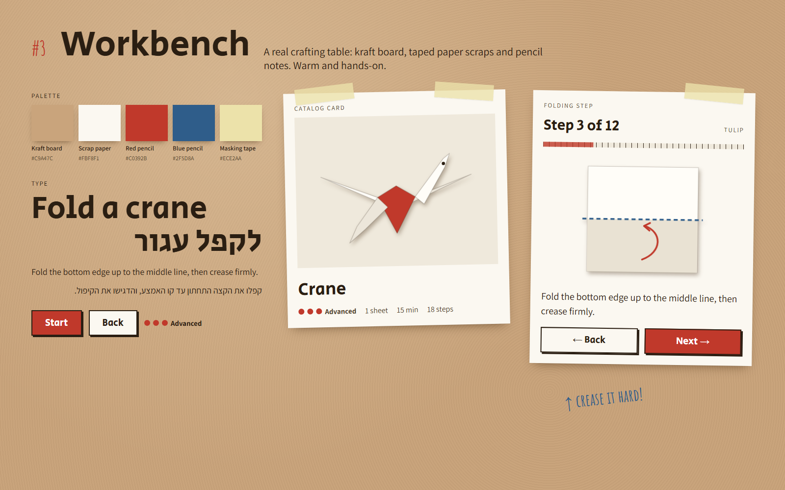
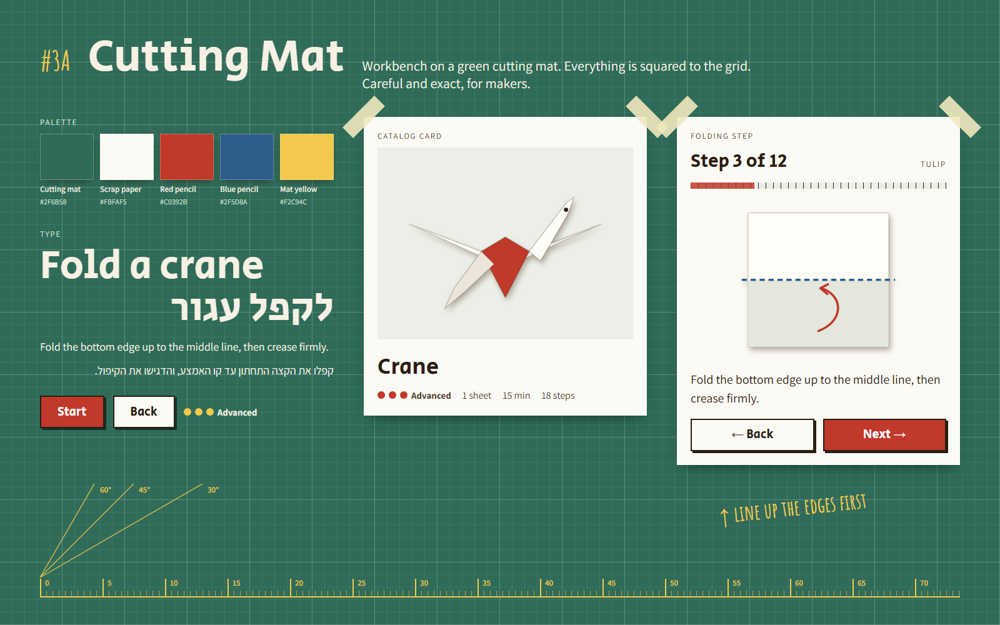
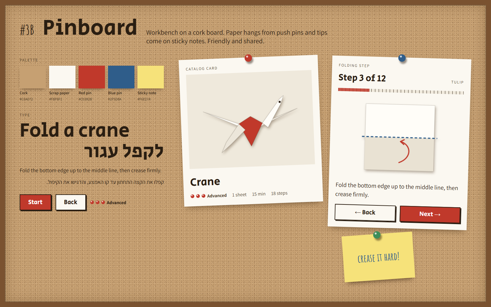
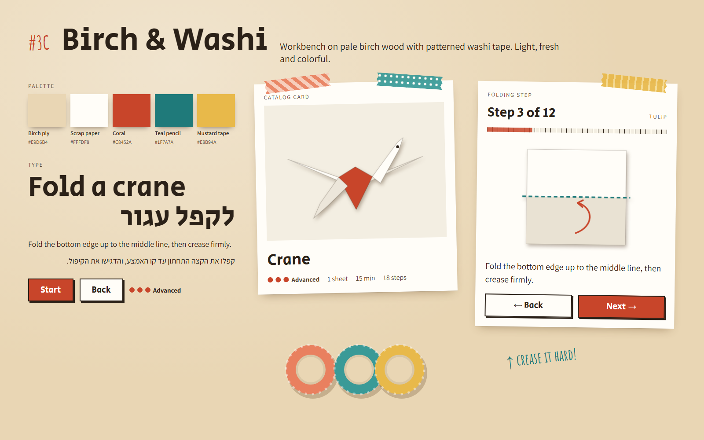
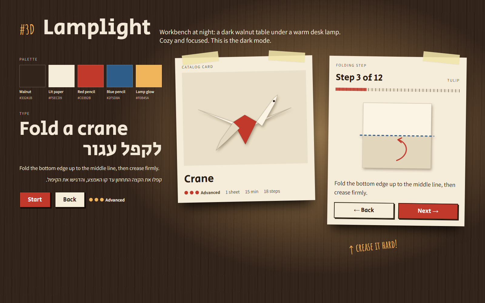

# Archive: Workbench and its variations (round 2)

Status: **archived**. The owner chose variation **3C, Birch & Washi**. It is the final style: see [docs/design/README.md](../../../README.md) and the [demo](../../../demo.html). The other variations below are kept for reference only.

Round 1 offered five style systems. The owner chose option 3, **Workbench**. The other four are kept, not deleted, in [../round-1/](../round-1/README.md).

This round offers four variations of Workbench. They change the visual language only, not the screens, flows or PRD requirements.

## The chosen style: Workbench

**Meaning.** Folding is something you do with your hands, on a table. The app looks like a crafting table: a table surface, paper scraps held in place, pencil marks and handwritten tips. It feels like a friend's notes next to you.

**What every variation keeps**
- **Type:** *Secular One* for headings and buttons, *Assistant* for reading text, *Amatic SC* only for short handwritten notes. All three support Hebrew.
- **Scraps:** content sits on off-white paper scraps with real shadows.
- **Buttons:** hard offset shadow, like cut card. The primary button is filled with the accent color.
- **Fold diagram:** paper with a soft shadow, a dashed "pencil" fold line and a hand-drawn arrow.
- **Progress:** a ruler-style bar with tick marks.

**What a variation changes**
1. the **table** (surface color and texture)
2. the **holder** (what keeps the paper in place)
3. the **marks** (the pencil and accent colors)
4. one **signature detail**

## How to read the boards

Each image is a 1600×1000 board with the same content as in round 1: palette, type (English and Hebrew), a catalog card and a folding step.

| # | Name | Table | Holder | Mood | Board |
|---|---|---|---|---|---|
| 3A | Cutting Mat | green cutting mat with a grid | tape across the corners | exact, tidy, maker | [03a-workbench-cutting-mat.png](03a-workbench-cutting-mat.png) |
| 3B | Pinboard | cork board in a wooden frame | push pins | friendly, shared, classroom | [03b-workbench-pinboard.png](03b-workbench-pinboard.png) |
| 3C | Birch & Washi | pale birch wood | patterned washi tape | light, fresh, colorful | [03c-workbench-birch-washi.png](03c-workbench-birch-washi.png) |
| 3D | Lamplight | dark walnut under a desk lamp | masking tape | cozy, focused, evening | [03d-workbench-lamplight.png](03d-workbench-lamplight.png) |

---

## 3A. Cutting Mat

**Meaning.** The green self-healing cutting mat is the surface of people who measure before they cut. This variation says: folding is a careful craft, and accuracy is part of the fun. It is the Workbench for makers.

**What changes**
- **Table:** mat green (`#2F6B58`) with a fine grid and a stronger line every 100px. Text on the table is cream, not dark.
- **Holder:** masking tape across the corners. The scraps are **not rotated**. Everything is squared to the grid.
- **Marks:** red and blue pencil stay. Mat yellow (`#F2C94C`) is added for marks printed on the mat and for handwritten tips.
- **Signature detail:** a ruler scale along the edge and angle guides (30°, 45°, 60°), as on a real mat.

**Good for:** teens and adults, and for accurate models where alignment matters. With no rotation it is also the simplest of the four to build, and the calmest layout to read.
**Watch out for:** the grid must stay faint so it does not compete with the content. It is cooler and less cozy than the kraft table. Red has low contrast on green, so red is used only on the scraps, never directly on the mat.

## 3B. Pinboard

**Meaning.** A cork board is where a class or a family pins up what it made. This variation turns the table into a wall. Guides hang like notices, and tips come on sticky notes. It says: we fold together, and we show our work.

**What changes**
- **Table:** cork (`#C6A072`) with a speckle texture, inside a wooden frame.
- **Holder:** round push pins instead of tape. Paper hangs from one point, so it swings a little more than in the base style.
- **Marks:** red and blue stay, now as pin colors too. Sticky-note yellow (`#F6E27A`) is added.
- **Signature detail:** tips are written on a pinned sticky note. The level indicator is made of small pin heads.

**Good for:** classrooms and families. It fits the "completed" screen well, because finished models can be pinned up like a gallery.
**Watch out for:** the frame takes space on small screens, so on mobile it should shrink or disappear. Pins and sticky notes are decorative and must not look like buttons. The cork speckle must stay light under text.

## 3C. Birch & Washi

**Meaning.** Washi tape is Japanese paper tape with printed patterns. It links the craft table back to Japanese paper without copying a traditional style. On a pale birch table it feels like a modern craft studio: bright, clean and a little playful.

**What changes**
- **Table:** pale birch plywood (`#E9D6B4`) as a smooth surface with a soft light gradient and no grain lines. It is the lightest of the four.
- **Holder:** patterned washi tape with torn ends: coral stripes, teal dots and mustard bands.
- **Marks:** coral (`#C8452A`) replaces red pencil for actions and progress. Teal (`#1F7A7A`) replaces blue pencil for fold lines and handwritten tips.
- **Signature detail:** the tape patterns. Each guide category or level can get its own tape pattern, and the rolls of tape can appear in empty states.

**Good for:** a wide audience, including younger users. It has the best contrast in bright rooms, and it is the closest to print.
**Watch out for:** three tape patterns are enough. More becomes noisy. Tape patterns must not be the only way to tell categories apart. Mustard and the light coral stripe are for decoration only, never for text.

## 3D. Lamplight

**Meaning.** Many people fold in the evening, at a desk, under one lamp. This variation is the same table at night: dark walnut wood, a warm pool of light and paper that seems to glow. It says: this is your quiet time.

**What changes**
- **Table:** dark walnut (`#33241B`) with a warm light pool behind the content. Text on the table is cream.
- **Holder:** masking tape, as in the base style.
- **Marks:** red and blue pencil stay on the paper. Lamp amber (`#F0B45A`) is used for marks and tips on the dark table.
- **Signature detail:** the light pool. It can follow the active scrap, so the current step is the brightest thing on the screen.

**Good for:** adults and evening use. It also answers the open point from round 1, where dark mode was marked "hard" for Workbench: this *is* the dark mode.
**Watch out for:** it can work as a full style or only as the dark theme of another variation. The paper must stay slightly warm and dimmed (`#F5ECD9`), because pure white glares on a dark table. Shadows are deeper, so they need testing on low-quality screens.

---

## Comparison

| | 3A Cutting Mat | 3B Pinboard | 3C Birch & Washi | 3D Lamplight |
|---|---|---|---|---|
| Mood | exact, tidy | friendly, shared | light, fresh | cozy, focused |
| Best age | teens and adults | children, families | all | adults |
| Table brightness | dark | medium | light | very dark |
| Rotated scraps | no | yes, the most | yes, slight | yes, slight |
| Build effort | low | medium | medium | low to medium |
| Works as dark mode | partly | no | no | **yes** |
| Mobile | easy | frame needs care | easy | easy |

The variations can be combined, because all four share the same type, scraps and buttons. Two examples:
- **3C by day, 3D by night:** Birch & Washi as the light theme and Lamplight as the dark theme.
- **3A layout with 3B details:** the straight, grid-aligned scraps of Cutting Mat, with sticky-note tips from Pinboard.

## Accessibility notes (all variations)

- Text color pairs were chosen to meet WCAG 2.2 AA (4.5:1): on the table and on the scraps.
- White button text sits only on red (`#C0392B`) or coral (`#C8452A`). Both pass 4.5:1.
- Yellow, mustard and amber are used for large handwritten notes and decoration on dark tables only, never for body text on paper.
- Fold meaning never depends on color alone: fold lines also differ in dash pattern.
- Rotation, tape, pins and textures are decorative. The reading layout and focus order stay straight. Rotation is turned off on small screens and when reduced motion is on.
- Fold diagrams never mirror in RTL (as in the PRD). UI arrows do.

## Sources and re-rendering

- Single source: `src/workbench.html?v=mat|cork|birch|lamp`. `v=base` shows the chosen Workbench style with the same code. It loads its fonts from Google Fonts.
- Re-render the four variation boards from the repo root in PowerShell: `& .\docs\design\archive\style-options\round-2\src\render.ps1` (headless Edge, 1600×1000).
- The boards show the content in English, with a Hebrew line in each type sample. Full Hebrew RTL screens will be made for the chosen variation.
- The source and boards of the four archived options are in [../round-1/](../round-1/README.md).
